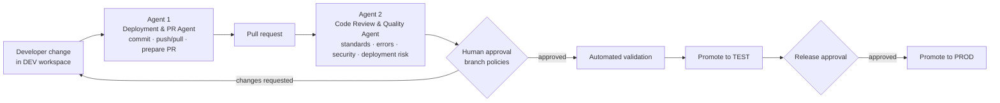
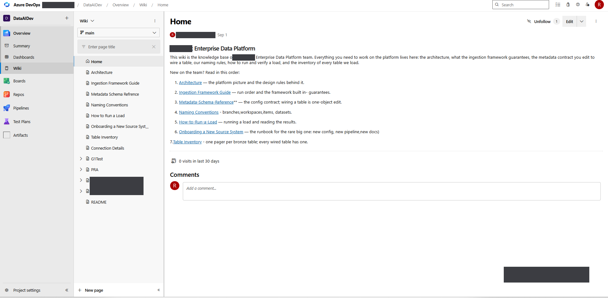
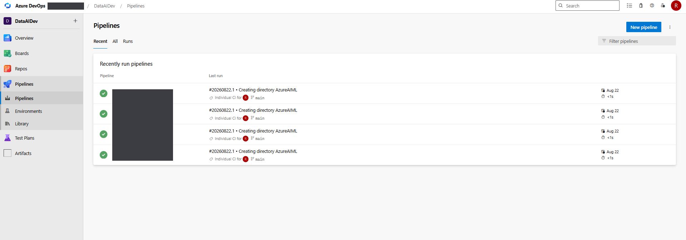
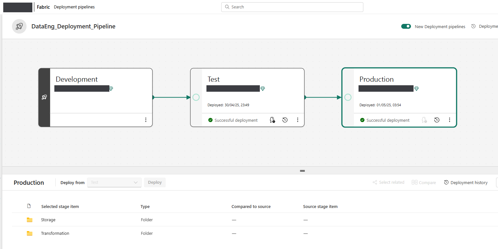

# Azure DevOps: Agentic CI/CD for Microsoft Fabric

> A governed CI/CD framework that keeps Microsoft Fabric **DEV, TEST and PROD** environments in sync through **Azure DevOps**. Two AI agents help along the way: a **Deployment & PR Agent** that prepares and moves changes, and a **Code Review & Quality Agent** that checks every change before human approval.

`Azure DevOps Repos` · `Azure Pipelines` · `Pull requests & branch policies` · `Microsoft Fabric Git integration` · `Fabric deployment pipelines` · `AI agents` · `Azure DevOps Wiki`

---

## Overview

Without a disciplined promotion process, Fabric environments drift apart. Notebooks, pipelines and semantic models get edited directly in production, configurations diverge, and nobody can say what changed or when. This project set up a **single, controlled path from development to production** and added AI agents to cut the manual work and catch problems earlier.

## Problem and goals

**Problem**
- Manual promotion of Fabric artifacts between environments was slow and error-prone.
- Configurations drifted between DEV, TEST and PROD.
- Code review depended entirely on reviewer availability and consistency.
- Change history and approvals were hard to trace.

**Goals**
- Connect all three environments to Azure DevOps repositories and deployment processes.
- Automate synchronization and promotion **DEV → TEST → PROD** behind approval gates.
- Use AI agents to prepare changes and pre-review them before a human approves.
- Make every change traceable through version control, pull requests and deployment history.

## Solution and workflow

1. **Change.** A developer works in the DEV workspace, which is connected to an Azure DevOps repository.
2. **Agent 1 (Deployment & PR Agent)** handles the code-movement work: push/pull operations, keeping environments in sync, preparing the pull request and running deployment activities.
3. **Agent 2 (Code Review & Quality Agent)** reviews the proposed change automatically for code quality, standards, likely errors, security concerns and deployment risk, **before approval**.
4. **Human approval.** Branching, pull-request, approval and release controls protect TEST and PROD.
5. **Validation and promotion.** Automated validation runs before changes move between environments. Fabric deployment pipelines promote content DEV → TEST → PROD.
6. **Traceability.** Version control, PR history, deployment history and approvals give a full audit trail. A team wiki documents the architecture, the ingestion framework, the metadata contract, naming conventions, runbooks and onboarding of new source systems.

## Architecture and technologies

| Component | Technology | Purpose |
|---|---|---|
| Source control | Azure DevOps Repos + Fabric Git integration | Versions Fabric items per environment |
| Policies | Branch policies, pull requests, approvals | Protect TEST/PROD and enforce review |
| Automation | Azure Pipelines | Validation and deployment automation |
| Promotion | Fabric deployment pipelines (Development → Test → Production) | Move Fabric content between stage workspaces |
| AI agents | Deployment & PR Agent, Code Review & Quality Agent | Automate change preparation and pre-review |
| Documentation | Azure DevOps Wiki | Architecture, framework guide, metadata schema reference, naming conventions, runbooks |

## Key features

- An end-to-end **DEV → TEST → PROD** promotion path with approval gates.
- **AI pre-review** of every change for quality, security and deployment risk.
- Automated synchronization that keeps environment configurations consistent.
- A full audit trail across commits, PRs, approvals and deployments.
- A documented platform wiki for onboarding and operations.

## Business value

- **Lower deployment risk:** issues are caught by the review agent and validation before they reach production.
- **Faster delivery:** less manual effort to prepare, review and promote changes.
- **Consistency:** environments stay aligned, with no hand-edited production drift.
- **Audit readiness:** every production change is traceable to a PR and an approver.

## Screenshots

| Platform wiki | Pipeline runs |
|---|---|
|  |  |
| Team wiki: architecture, framework guide, metadata schema, naming, runbooks | CI pipelines running on the `main` branch |

| Fabric deployment pipeline |
|---|
|  |
| Development → Test → Production stages with successful deployments |

## Security and controls

- **Humans stay in the loop:** production changes go through pull requests and approval and release controls. The review agent advises, and the approver decides.
- **Least privilege:** pipeline and agent identities should be scoped to the repositories and environments they need.
- **No secrets in repos:** credentials stay in secure pipeline variables or Key Vault, never in code.
- Organization, project, repository and pipeline names are redacted in this repository.

## My role

I designed and implemented the CI/CD framework: environment integration with Azure DevOps, branching and approval controls, Fabric deployment pipelines, and the two agentic pipeline components. I also authored the platform wiki.

---
Organization names, accounts and repository identifiers have been removed.
